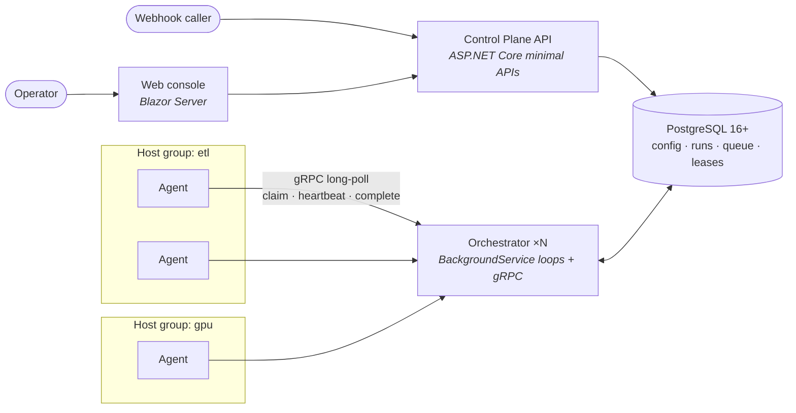
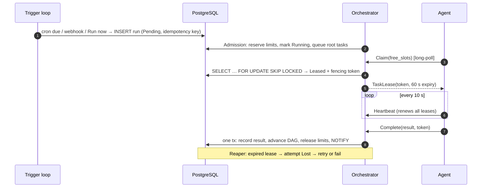
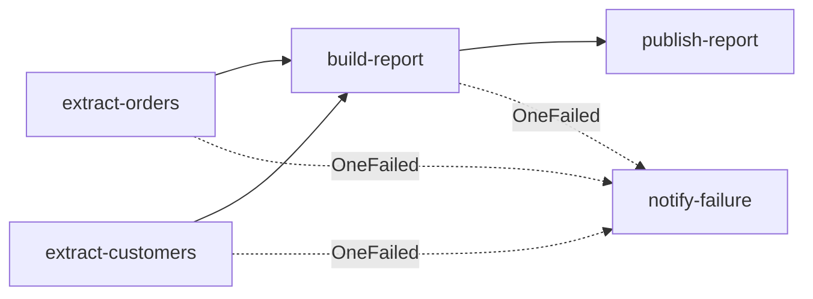

<div align="center">

# Baton

**A workflow engine and automations platform for .NET, built on PostgreSQL alone.**

Define workflows as versioned C# DAGs, trigger them on a schedule, by hand or by webhook, and let a
replicated orchestrator hand their tasks to pools of worker hosts. It enforces limits and priorities,
and fenced leases keep a stale worker from ever overwriting a newer result.

[](https://github.com/quenzvezda/baton/actions/workflows/ci.yml)


[](LICENSE)

[Architecture](#architecture) ·
[Defining a workflow](#defining-a-workflow) ·
[Design decisions](#key-design-decisions) ·
[Roadmap](#roadmap) ·
[Getting started](#getting-started)

</div>

---

> [!NOTE]
> **Project status: M0 (Foundation).** The design, the architecture decisions and the
> specifications for every v1 milestone are complete. The solution skeleton, public SDK,
> gRPC contract, baseline schema and test harness are in place. Engine behavior is
> being built milestone by milestone, spec first. See [Roadmap](#roadmap).

## Why Baton?

Teams that outgrow cron jobs and ad-hoc scripts usually want three things together:

- **DAG workflows in real code.** Branches run in parallel, with retries, timeouts and trigger rules.
- **Control over where and how much runs.** Tasks go to specific groups of machines, with
  concurrency limits and priorities, so a heavy ETL never starves an urgent report.
- **Operational simplicity.** No extra broker, cache or coordination service to run and secure.

Existing .NET options each cover part of this. Temporal is powerful but brings its own cluster.
Hangfire is a job queue, not a DAG engine. Elsa focuses on runtime-authored workflows. Baton targets
the gap: **Airflow-style DAGs in C#, host-group routing and fenced at-least-once execution, all
coordinated through PostgreSQL alone.**

## Highlights

| | |
| --- | --- |
| 🧩 **Workflows as code** | DAGs declared with a fluent C# builder, validated at startup (acyclic, unique keys, resolvable handlers) and registered as immutable `key@version` entries keyed by a SHA-256 graph hash. |
| ⏱️ **Three trigger types** | Cron with IANA time zones, manual *Run now*, and HMAC-signed webhooks. Each firing creates exactly one run, deduplicated by an idempotency key. |
| 🎯 **Host-group routing** | Each automation targets a pool of agents. Labels narrow eligibility further, and dispatch only picks hosts whose build carries the task's definition hash, which keeps rolling deploys safe. |
| 🚦 **Limits & priorities** | Concurrency caps per automation, workflow, host group and host. Priority 0–100 ages upward while work waits, so nothing starves. Concurrency policies: Skip, Queue, Replace, Allow. |
| 🔒 **Leases with fencing** | Every claim carries a monotonic fencing token. A stale worker's result is rejected with `FAILED_PRECONDITION`, so no task runs twice at the same time. |
| 🔁 **Retries & cancellation** | Exponential backoff with jitter, `NonRetryableException` for fail-fast errors, task and run timeouts, and cooperative cancellation with a grace period. |
| 🐘 **PostgreSQL only** | Config, run state, the task queue, leases and wake-ups (`LISTEN/NOTIFY`) live in one database. Every state transition is one transaction. |
| 📈 **Scales out** | API and orchestrator run as N replicas, with singleton loops elected through advisory locks. Agents self-register and pull work over outbound-only gRPC. |

## Architecture

Four deployables share a single PostgreSQL database. Agents **pull** work, and nothing ever pushes
to them, so a host behind a firewall only needs outbound access to the orchestrator.



| Component | Responsibility |
| --- | --- |
| **Web console** | Automation editor, workflow catalog with DAG view, runs, hosts and queue dashboard. Talks to the API only. |
| **Control Plane API** | CRUD for automations, triggers and host groups. Handles *Run now* and webhook intake, and registers workflow definitions at startup. |
| **Orchestrator** | Trigger loop, admission, DAG advance, dispatch, lease reaping, retry promotion and priority aging. Safe to run as several replicas. |
| **Agent** | Registers, heartbeats, claims tasks, runs handlers with timeouts, streams logs and reports fenced results. |
| **Definitions** | Workflow classes and task handlers, shipped as a NuGet package referenced by API, orchestrator and agents. |

### How a run flows



## Defining a workflow

Workflows are plain C# classes. Two extracts run in parallel, the report waits for both, and a
notification runs only if something failed:

```csharp
public sealed record SalesReportParams(string Region, DateOnly? ReportDate, string[] Recipients);

public sealed class NightlySalesReport : WorkflowDefinition<SalesReportParams>
{
    public override string Key => "nightly-sales-report";
    public override int Version => 2;   // bump on any change to the graph or options

    protected override void Define(IWorkflowBuilder<SalesReportParams> wf)
    {
        var orders = wf.Task<ExtractOrders>("extract-orders")
            .Retry(maxAttempts: 4, initialDelay: TimeSpan.FromSeconds(30))
            .Timeout(TimeSpan.FromMinutes(15));

        var customers = wf.Task<ExtractCustomers>("extract-customers")
            .Retry(3, TimeSpan.FromSeconds(30));

        var report = wf.Task<BuildReport>("build-report")
            .DependsOn(orders, customers)
            .RequireLabels("large-memory");

        wf.Task<PublishReport>("publish-report").DependsOn(report);

        wf.Task<NotifyOnFailure>("notify-failure")
            .DependsOn(orders, customers, report)
            .When(TriggerRule.OneFailed);
    }
}
```



Handlers are resolved from DI per attempt, read their ancestors' outputs and get a stable idempotency
key, since execution is at-least-once:

```csharp
public sealed class BuildReport(IReportRenderer renderer)
    : ITaskHandler<SalesReportParams, ReportOutput>
{
    public async Task<ReportOutput> ExecuteAsync(
        TaskContext<SalesReportParams> ctx, CancellationToken ct)
    {
        var orders = ctx.GetOutput<OrdersExtract>("extract-orders");
        var customers = ctx.GetOutput<CustomersExtract>("extract-customers");
        ctx.Logger.LogInformation("Rendering {Count} orders for {Region}", orders.Count, ctx.Params.Region);

        var uri = await renderer.RenderAsync(orders, customers, ctx.IdempotencyKey, ct);
        return new ReportOutput(uri);
    }
}
```

The SDK surface lives in [`src/Baton.Abstractions`](src/Baton.Abstractions).

## Key design decisions

Every significant choice is recorded as an [Architecture Decision Record](docs/adr/), with the
alternatives that were rejected.

| Decision | Rationale | ADR |
| --- | --- | --- |
| PostgreSQL is the only stateful dependency | One system to operate, back up and secure. Transactions give atomic state changes for free. | [0003](docs/adr/0003-postgresql-as-single-source-of-truth.md) |
| Static C# definitions, immutable `key@version` | Compile-time safety and code review for workflows. Runs always know the exact graph they used. | [0004](docs/adr/0004-static-csharp-workflow-definitions.md) |
| Pull-based agents over gRPC long-poll | Agents need outbound access only. Capacity is reported by the worker itself. | [0005](docs/adr/0005-pull-based-agents-over-grpc.md) |
| At-least-once with leases and fencing tokens | Exactly-once is unachievable for arbitrary side effects. Fencing guarantees no concurrent execution and no stale writes. | [0006](docs/adr/0006-at-least-once-execution-leases-and-fencing.md) |
| Hand-written SQL on the hot path | Claim, heartbeat, complete and reap stay predictable and index-friendly. EF Core handles everything else. | [0007](docs/adr/0007-hand-written-sql-on-the-hot-path.md) |
| `SKIP LOCKED` + transaction-scoped advisory locks | Replica-safe loops without a coordination service. | [0008](docs/adr/0008-replica-coordination-in-postgres.md) |
| Concurrency limits as counter rows | Limits are reserved in the same transaction as the state change they guard, locked in key order to avoid deadlocks. | [0009](docs/adr/0009-concurrency-limits-as-counter-rows.md) |
| UUIDv7 identifiers | Time-ordered keys avoid B-tree fragmentation on high-insert tables and need no coordination to generate. | [0010](docs/adr/0010-uuidv7-identifiers.md) |
| Monthly partitions, 90-day retention | Old history is removed by dropping whole partitions instead of row-by-row `DELETE`, so tables don't bloat. | [0011](docs/adr/0011-history-partitioning-and-retention.md) |

## Tech stack

| Area | Technology |
| --- | --- |
| Runtime | .NET 10, C# (latest), nullable reference types, central package management |
| Services | ASP.NET Core minimal APIs, `BackgroundService`, Worker Service |
| Agent protocol | gRPC + Protocol Buffers ([`agent.proto`](src/Baton.Agent.Protocol/Protos/agent.proto), package `baton.agent.v1`) |
| Persistence | PostgreSQL 16+, EF Core + Npgsql for configuration, Dapper + hand-written SQL for the queue |
| Scheduling | Cronos (cron expressions with time zones) |
| UI | Blazor Server ([ADR-0012](docs/adr/0012-web-ui-framework.md), proposed) |
| Observability | OpenTelemetry (traces, metrics, logs via OTLP) |
| Testing | xUnit, Testcontainers for PostgreSQL |
| CI | GitHub Actions: build, unit + integration tests, OpenSpec validation |

## Roadmap

Delivery is split into scope-based milestones, each backed by one [OpenSpec](https://github.com/Fission-AI/OpenSpec)
change with requirements, design and verifiable tasks. All 49 requirements from the design spec are
mapped to a milestone.

| | Milestone | Scope | Status |
| --- | --- | --- | --- |
| **M0** | [Foundation](docs/milestones/M0-foundation.md) | Solution, migrations, Postgres test harness, CI | 🚧 In progress |
| **M1** | [Workflow definitions](docs/milestones/M1-workflow-definitions.md) | Builder, DAG validation, hashing, registration | 📝 Specified |
| **M2** | [Host registry](docs/milestones/M2-host-registry.md) | Agent registration, heartbeats, drain, access control | 📝 Specified |
| **M3** | [Task dispatch & leases](docs/milestones/M3-task-dispatch.md) | Claims, fencing, reaper, retries | 📝 Specified |
| **M4** | [Automations & run lifecycle](docs/milestones/M4-automations-and-run-lifecycle.md) | Triggers, admission, limits, cancellation | 📝 Specified |
| **M5** | [Web console & monitoring](docs/milestones/M5-web-console-and-monitoring.md) | Catalog, runs, DAG view, live logs, hosts | 📝 Specified |
| **G1** | [v1 production readiness](docs/milestones/G1-v1-production-readiness.md) | Load, chaos and security gate | — |
| M6–M8 | [Phase 2 & 3](ROADMAP.md) | Aging, pinned runs, audit log, re-run from failure, OTel, extensibility | Planned |

Full plan, dependency graph and gates: [ROADMAP.md](ROADMAP.md).

## Getting started

### Prerequisites

- [.NET 10 SDK](https://dotnet.microsoft.com/download)
- [Docker](https://www.docker.com/) (local PostgreSQL and Testcontainers)
- Node.js 20+ (only for the OpenSpec CLI)

### Build and test

```bash
git clone https://github.com/quenzvezda/baton.git
cd baton

docker compose up -d                        # PostgreSQL 16 on localhost:5432 (dev credentials)
dotnet tool restore                         # pinned dotnet-ef
dotnet ef database update -p src/Baton.Persistence -s src/Baton.ControlPlane.Api
dotnet build Baton.sln
dotnet test tests/Baton.Domain.Tests        # fast unit tests
dotnet test tests/Baton.Integration.Tests   # spins up Postgres via Testcontainers
```

### Run the services

Start each in its own terminal:

```bash
dotnet run --project src/Baton.ControlPlane.Api   # http://localhost:5100/healthz
dotnet run --project src/Baton.Orchestrator       # http://localhost:5200/healthz (gRPC on the same port)
dotnet run --project src/Baton.Agent              # outbound only
dotnet run --project src/Baton.Web                # http://localhost:5300
```

Telemetry (traces, metrics, logs) is exported over OTLP only when `OTEL_EXPORTER_OTLP_ENDPOINT` is set,
e.g. `http://localhost:4317` for a local OpenTelemetry Collector.

## Repository layout

```text
src/
  Baton.Abstractions/      Public SDK: IWorkflowDefinition, builder, ITaskHandler, TaskContext
  Baton.Definitions/       Workflows + handlers (NuGet package shared by API, orchestrator, agent)
  Baton.Domain/            Pure logic: states, DAG validation, trigger rules, backoff, aging (no I/O)
  Baton.Persistence/       EF Core DbContext + migrations; Queue/ holds hand-written hot-path SQL
  Baton.Agent.Protocol/    gRPC contract (agent.proto)
  Baton.ControlPlane.Api/  REST API, webhooks, definition registration
  Baton.Orchestrator/      Background loops + gRPC AgentService
  Baton.Agent/             Worker Service running on each host
  Baton.Web/               Blazor Server console
  Shared/                  Source linked into server projects (OpenTelemetry baseline)
tests/
  Baton.Domain.Tests/      Unit tests with injected time and randomness
  Baton.Integration.Tests/ Testcontainers PostgreSQL (schema, queue and concurrency tests)
docs/
  adr/                     Architecture Decision Records
  milestones/              Scope and exit criteria per milestone
  design/design-spec.md    Original design specification
openspec/                  Specs (built behavior) and changes (behavior in flight)
```

## Engineering practices

- **Spec-driven development.** Behavior is specified before it is built: OpenSpec change →
  implementation → archive ([ADR-0002](docs/adr/0002-spec-driven-development-with-openspec.md)).
  Requirement IDs (`AUT-xx`, `WF-xx`, `ORC-xx`, `HST-xx`, `OBS-xx`) trace from the design spec through
  specs and tasks to tests.
- **Decisions are written down.** Architectural choices land as ADRs. Accepted ADRs are immutable and
  only replaced by a superseding ADR.
- **Concurrency is tested for real.** Claims, fencing, admission and limits require integration tests
  with concurrent actors against a real PostgreSQL container. Mocks are not enough.
- **Invariants are explicit.** One transaction per state transition, time from Postgres `now()`, no
  bypassing the fencing token. The full list is in [AGENTS.md](AGENTS.md).

```bash
npx @fission-ai/openspec@1.14.1 list                     # changes in flight + task progress
npx @fission-ai/openspec@1.14.1 show add-task-dispatch   # read a change
npx @fission-ai/openspec@1.14.1 validate --all --strict
```

## Documentation

| Document | Contents |
| --- | --- |
| [Design spec](docs/design/design-spec.md) | Requirements, NFR targets, data model, hot-path queries, API surface |
| [ADRs](docs/adr/) | Why the architecture is the way it is |
| [ROADMAP.md](ROADMAP.md) | Phases, milestones M0–M8, gates G1–G2 |
| [Open questions](docs/open-questions.md) | Unresolved decisions with owners and deadlines |
| [AGENTS.md](AGENTS.md) | Contributor and AI-agent guide: commands, invariants, definition of done |

## License

Licensed under the [Apache License 2.0](LICENSE).
