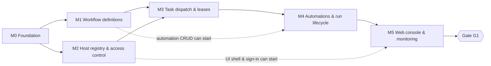
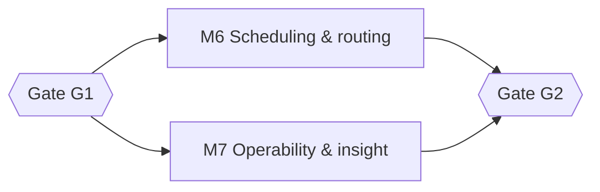

# Baton — Roadmap

Derived from design spec §10: **phase 1 is every Must, phase 2 the Shoulds, phase 3 the Coulds plus event
triggers.** Each gate must pass before the next phase starts. Milestones are scope-based; dates are set
once team capacity and OQ-01 (expected scale) are known.

Each milestone maps to one OpenSpec change (ADR-0002). Phase-1 changes are already written in
`openspec/changes/`; phase-2/3 changes are created when the milestone starts
(`openspec new change <id>` or the `openspec-propose` skill).

## Overview

| Milestone | Theme | Requirements | OpenSpec change | Status |
| --- | --- | --- | --- | --- |
| [M0](docs/milestones/M0-foundation.md) | Foundation | — (tooling) | `bootstrap-foundation` | Done |
| [M1](docs/milestones/M1-workflow-definitions.md) | Workflow definitions | WF-01..08, WF-09 (API) | `add-workflow-definitions` | Done |
| [M2](docs/milestones/M2-host-registry.md) | Host registry, agent protocol, access control | HST-01..05, HST-06 (API), NFR-Security | `add-host-registry` | Planned |
| [M3](docs/milestones/M3-task-dispatch.md) | Task dispatch & leases | ORC-03, 04, 05, 07, 08, 09, 10 | `add-task-dispatch` | Planned |
| [M4](docs/milestones/M4-automations-and-run-lifecycle.md) | Automations, triggers & run lifecycle | AUT-01..07, AUT-09, ORC-01, 02, 11 | `add-automations-and-run-lifecycle` | Planned |
| [M5](docs/milestones/M5-web-console-and-monitoring.md) | Web console & run monitoring | OBS-01..03, WF-09 (UI), HST-06 (UI), AUT-03 (form) | `add-web-console-and-monitoring` | Planned |
| **[G1](docs/milestones/G1-v1-production-readiness.md)** | **Gate: v1 production readiness** | NFRs (§3) | — | — |
| [M6](docs/milestones/M6-scheduling-and-routing.md) | Scheduling & routing controls | AUT-08, AUT-10, ORC-06, ORC-12, ORC-13 | `add-scheduling-and-routing-controls` *(to create)* | Phase 2 |
| [M7](docs/milestones/M7-operability-and-insight.md) | Operability & insight | AUT-11, WF-10, OBS-04, OBS-05, OBS-06 | `add-operability-and-insight` *(to create)* | Phase 2 |
| **[G2](docs/milestones/G2-phase-2-exit.md)** | **Gate: phase 2 exit** | SLOs in production | — | — |
| [M8](docs/milestones/M8-extensibility.md) | Extensibility | AUT-12, WF-11, ORC-14, event triggers | `add-*` *(to create, likely several)* | Phase 3 |

**Coverage check:** 36 Musts → M0–M5 · 10 Shoulds → M6–M7 · 3 Coulds + event triggers → M8 (49/49).

## Phase 1 — v1 (all Musts)

- **M1 and M2 run in parallel** after M0 — they share only the solution and the schema.
- **M3 is the critical path**: claim/lease/fencing correctness and the integration test rig.
- Automation CRUD (M4 §1) only needs M1; triggers, admission and finalization need M3.

## Phase 2 — Shoulds

M6 and M7 are independent. **OQ-03** (do workflows need a single host?) can pull PinnedRun (ORC-12) forward
into phase 1 — decide before M3 closes.

## Phase 3 — Coulds + event triggers

M8 after G2. WF-11 (JSON/YAML definitions edited in the UI) supersedes part of ADR-0004 and needs a new ADR.
Event triggers are not specified yet — write a proposal first.

## Out of scope (v1 and current roadmap)

Preemption of running tasks, multi-region, runtime authoring before phase 3 (design spec §1).

## How to update this roadmap

- Changing scope of a milestone ⇒ update the milestone doc **and** its OpenSpec change in the same PR.
- Moving a requirement between phases ⇒ change its priority in the design spec table, note it here.
- Marking a milestone done ⇒ its change is archived (`openspec archive <id>`) and exit criteria are ticked.
